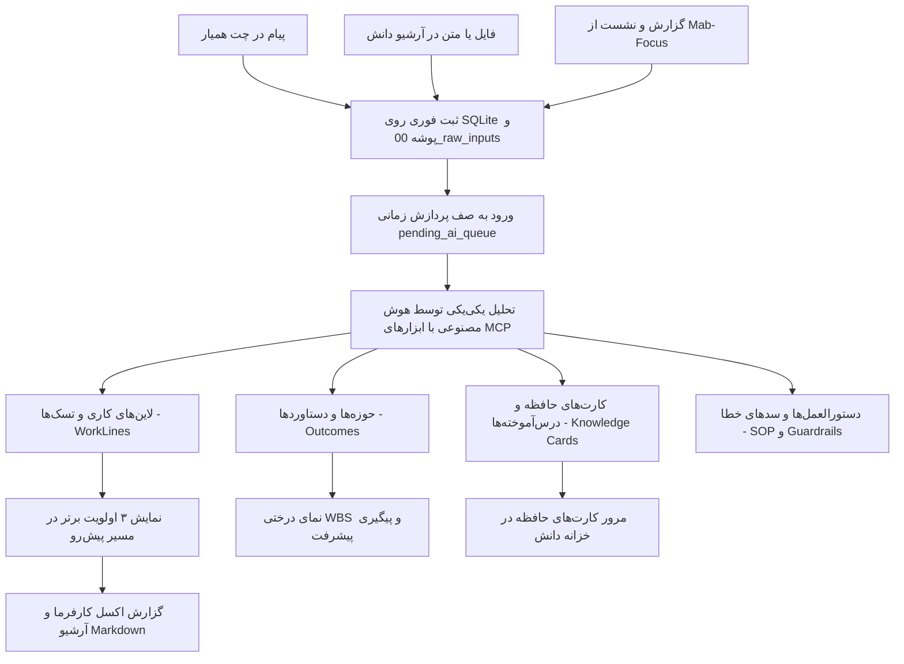
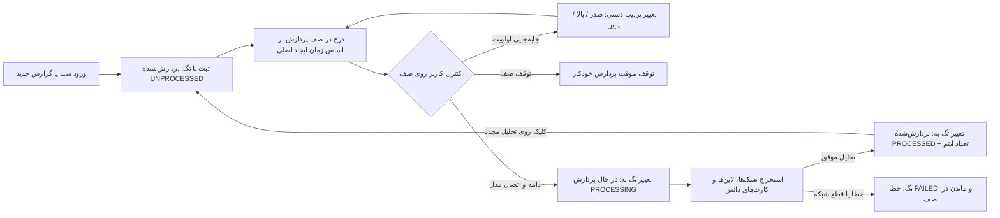
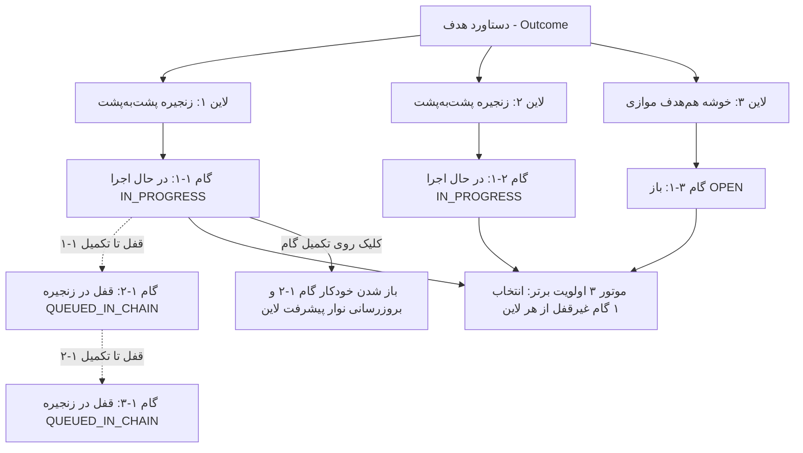
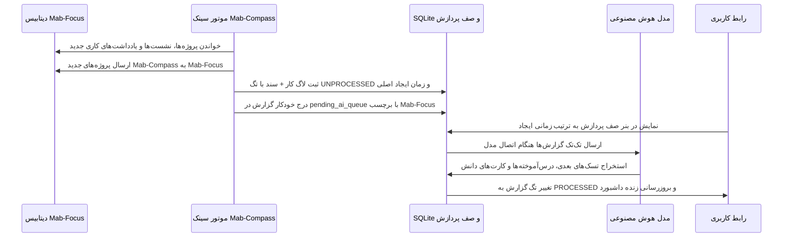
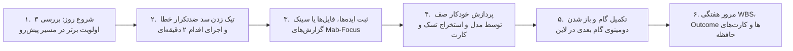

# راهنمای جامع و نقشه ورک‌فلوهای اپلیکیشن Mab-Compass v3.0

---

## ۱. Mab-Compass چیست؟ (معرفی اپلیکیشن)

**Mab-Compass** یک **سیستم‌عامل شخصی اجرا، دانش و هم‌راستاسازی هدف‌محور** (دسکتاپ، محلی و آفلاین‌اول) بر پایه **Tauri v2 + Rust + SQLite + React** است.

بیشتر ابزارهای مدیریت کار یا صرفاً یک لیست ساده To-Do هستند (که به‌سرعت تبدیل به انباری شلوغ و پراسترس از ده‌ها کار پراکنده می‌شود)، یا صرفاً یک ابزار یادداشت‌برداری بدون اتصال به اجرا هستند. **Mab-Compass** این شکاف را با ترکیب سه دنیای مختلف در یک محیط واحد حل می‌کند:

1. **مغز پردازشگر ورودی‌ها (AI Knowledge & Task Extractor):** هر پیام، فایل (PDF، DOCX، کد، متن)، صورت‌جلسه یا گزارش تمرکز از **Mab-Focus** را می‌گیرد، در حافظه دائمی ذخیره می‌کند و به ترتیب زمانی ایجاد توسط هوش مصنوعی (مدل محلی یا ابری) کالبدشکافی می‌کند.
2. **موتور اجرای هدف‌محور ۵ لایه (Outcome-Driven Execution Engine):** به‌جای نشان دادن ۵۰ تسک درهم‌ریخته، کارها را در قالب **۸ بُعد زندگی/کار ← دستاوردها (Outcomes) ← لاین‌های کاری (WorkLines) ← گام‌های اجرایی** می‌چیند و در لحظه فقط **۳ اولویت برتر از ۳ لاین مجزا** را همراه با «اولین اقدام فیزیکی ۲ دقیقه‌ای» جلوی چشمتان می‌گذارد.
3. **خزانه دانش اتمیک و ضدتکرار خطا (Atomic Knowledge Vault & Guardrails):** از دل هر سند و تجربه، **کارت‌های حافظه (Flashcards)**، **درس‌آموخته‌ها**، **دستورالعمل‌های اجرایی (SOP)**، **تصمیمات معماری (ADR)** و **سدهای پیشگیرانه ضدتکرار خطا** استخراج می‌کند تا هیچ تجربه و دانشی دفن نشود.

---

## ۲. چه کار می‌کند؟ خروجی‌ها و ارزشی که خلق می‌کند

### ارزشی که خلق می‌کند (چرا مهم است؟)
- **پایان آشفتگی و فلج تصمیم‌گیری:** لازم نیست هر صبح میان ده‌ها کار فکر کنید «الان کدام را انجام دهم؟». اپ فقط ۳ گامِ آماده و غیرقفل از ۳ لاین کاری مختلف را با اقدام شروع ۲ دقیقه‌ای نشان می‌دهد.
- **هیچ ورودی و ایده‌ای گم نمی‌شود (Offline-First):** حتی اگر اینترنت یا مدل هوش مصنوعی قطع باشد، هر پیام، فایل یا گزارش Mab-Focus بلافاصله روی دیسک و SQLite ثبت می‌شود، تگ **«پردازش‌نشده»** می‌گیرد و در صف زمانی می‌ماند تا به‌محض اتصال مدل، یکی‌یکی تحلیل شود.
- **جلوگیری از توقف کل پروژه در یک گلوگاه:** با تقسیم تسک‌ها به لاین‌های کاری مجزا (`SEQUENTIAL_CHAIN` پشت‌به‌پشت یا `GOAL_CLUSTER` هم‌هدف)، اگر یک لاین منتظر پاسخ دیگران باشد، روی ۲ لاین فعال دیگر بدون اتلاف وقت پیش می‌روید.
- **تبدیل اسناد خام به دانش قابل مرور و قابل اجرا:** یک سند طولانی دیگر صرفاً در یک پوشه خاک نمی‌خورد؛ تبدیل به تسک، لاین کاری، کارت حافظه قابل مرور، درس‌آموخته و قانون SOP می‌شود.
- **آرشیو شفاف و مالکیت ۱۰۰٪ داده:** تمام داده‌ها روی سیستم خودتان در SQLite و فایل‌های استاندارد Markdown (در ۸ پوشه منظم) ذخیره می‌شوند و هر زمان خواستید خروجی **اکسل گزارش کارفرما** می‌گیرید.

### خروجی‌های ملموس Mab-Compass

| دسته خروجی | توضیح دقیق | محل مشاهده در اپ |
|---|---|---|
| **۳ اولویت برتر اجرایی** | یک گام فعال/آماده از هر لاین کاری برتر، همراه با اقدام شروع ۲ دقیقه‌ای و شرط تکمیل (DoD) | تب **مسیر پیش‌رو و همیار** |
| **درخت ۵ لایه WBS** | ساختار سلسله‌مراتبی `حوزه زندگی ← Outcome ← WorkLine ← تسک‌ها` با نوار پیشرفت و قفل زنجیره | تب **نقشه WBS و لاین‌ها** |
| **کارت‌های دانش و حافظه اتمیک** | کارت حافظه با حالت مرور (Flip/Reveal)، درس‌آموخته، دستورالعمل و نکته کلیدی | تب **اهداف و کارت‌های دانش** |
| **قوانین اجرایی (SOP) و تصمیمات (ADR)** | استانداردهای تکرارپذیر و تصمیمات معماری پروژه | تب **نقشه WBS و لاین‌ها** |
| **سدهای پیشگیرانه ضدتکرار خطا** | چک‌باکس‌هایی که قبل از شروع گام‌های حساس از تکرار اشتباهات قبلی جلوگیری می‌کنند | بالای تب **مسیر پیش‌رو** |
| **آرشیو اسناد با تگ پردازش** | اسناد خام و تحلیل‌شده با تگ `پردازش‌نشده / در حال پردازش / پردازش‌شده / خطا` | تب **آرشیو اسناد و دانش** |
| **ظرفیت روزانه و گزارش کارفرما** | برنامه‌ریزی دقایق کار عمیق، همگام‌سازی Mab-Focus و فایل Excel گزارش کارفرما | تب **اهداف و کارت‌های دانش** + نوار بالا |

---

## ۳. چطور کار می‌کند؟ (معماری و بخش‌های اصلی)

### معماری فنی ۳ لایه
- **لایه هسته و حافظه (Rust + SQLite WAL):** مدیریت پایگاه داده محلی، جستجوی تمام‌متن (FTS5)، موتور زنجیره دومینو، صف پردازش زمانی، همگام‌سازی دوطرفه با دیتابیس `Mab-Focus` و خروجی Markdown/Excel.
- **لایه هوش مصنوعی و ابزارهای MCP:** اتصال انعطاف‌پذیر به مدل‌های محلی (LM Studio / OpenAI-Compatible)، Gemini REST یا AGY CLI. هوش مصنوعی از طریق ابزارهای بومی MCP مستقیماً روی گراف پروژه (ساخت Outcome، لاین کاری، تسک، کارت حافظه، SOP و...) عمل می‌کند.
- **لایه رابط کاربری (React + TypeScript + Tauri v2):** محیط تاریک و راست‌به‌چپ (RTL) کاملاً ریسپانسیو با **پنل‌های کشیدنی به سبک VS Code** (فهرست راست، پنل وسط، پنل چت و آرشیو دانش همگی با کشیدن جداکننده تغییر اندازه می‌دهند و با دوبار کلیک ریست می‌شوند).

### ۵ بخش اصلی اپلیکیشن
1. **مسیر پیش‌رو و همیار (Path & Chat):** صفحه کار روزانه؛ سمت راست شامل سد ضدتکرار خطا، **۳ اولویت برتر اجرایی** و قوانین مرتبط، و سمت چپ چت هوشمند همیار (قابل کشیدن و تمام‌صفحه).
2. **آرشیو اسناد و دانش (Knowledge Vault):** محل رها کردن فایل‌ها و ورود متن آزاد؛ نمایش لیست اسناد با تگ وضعیت پردازش، فیلتر سریع (`همه / پردازش‌نشده / پردازش‌شده`) و دکمه تحلیل مجدد.
3. **نقشه WBS و لاین‌ها (WBS & Docs):** نمایش درختی `Outcome ← WorkLine ← تسک‌ها`، فیلتر ۴ بعدی کانتکست (انرژی، وسیله، فقط قابل اجرا)، دکمه‌های ساخت دستی (`+ Outcome`، `+ لاین کاری`، `+ تسک`) و تخصیص/جابه‌جایی سریع تسک‌ها + تب‌های ADR، SOP و لاگ‌های Mab-Focus.
4. **اهداف و کارت‌های دانش (Ecosystem & Cards):** شامل ۴ زیربخش: کارت‌های حافظه و درس‌آموخته‌ها (با حالت مرور حافظه)، ۸ بُعد زندگی CADM و مدیریت Outcomeها، پیشنهادهای زیرپروژه، و تقویم ظرفیت روزانه.
5. **تنظیمات و سینک (Settings):** انتخاب مدل هوش مصنوعی، مسیر پوشه Vault و مسیر دیتابیس `Mab-Focus`.

---

## ۴. ورک‌فلوهای کلیدی اپلیکیشن (با نمودار گرافیکی)

### ورک‌فلو ۱: نقشه کلان تبدیل ورودی‌های خام به اجرا و دانش

---

### ورک‌فلو ۲: چرخه حیات اسناد و صف پردازش زمانی قابل کنترل

---

### ورک‌فلو ۳: موتور دومینوی لاین‌های پشت‌به‌پشت و انتخاب ۳ اولویت برتر

---

### ورک‌فلو ۴: همگام‌سازی دوطرفه با Mab-Focus و پردازش گزارش‌ها

---

### ورک‌فلو ۵: روتین کار روزانه پیشنهادی با اپ

---

## ۵. نکات کلیدی کار با رابط کاربری (میان‌برها و قابلیت‌های کاربردی)

- **تغییر اندازه پنجره‌ها مثل VS Code:** جداکننده بین فهرست راست و فضای اصلی، همچنین جداکننده بین پنل وسط و چت را با ماوس بکشید؛ اندازه دلخواهتان ذخیره می‌شود و با **دوبار کلیک روی جداکننده** به حالت استاندارد برمی‌گردد.
- **کنترل کامل روی صف هوش مصنوعی:** در بنر بالای صفحه روی دکمه **«اولویت‌بندی»** کلیک کنید تا کل لیست موارد در انتظار (چت‌ها، اسناد و گزارش‌های Mab-Focus) را ببینید، صف را متوقف/ادامه دهید یا اولویت هر مورد را بالا و پایین ببرید.
- **مدیریت همزمان دستی و هوشمند:** هر جا خواستید از هوش مصنوعی در چت کمک بگیرید، و هر جا خواستید سریع دستی اقدام کنید، دکمه‌های **«+ Outcome جدید»**، **«+ لاین کاری جدید»**، **«+ تسک جدید»** و **«تخصیص»** مستقیماً در بالای صفحه WBS و کنار هر تسک در دسترس هستند.
