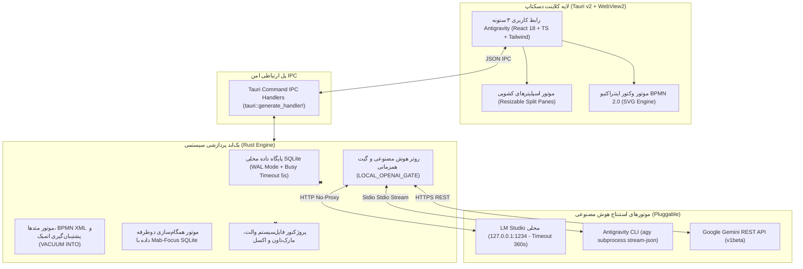
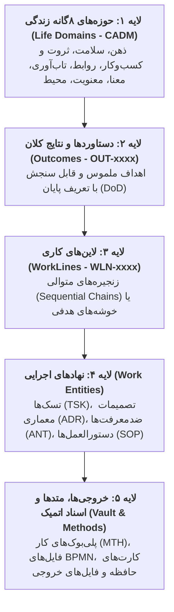
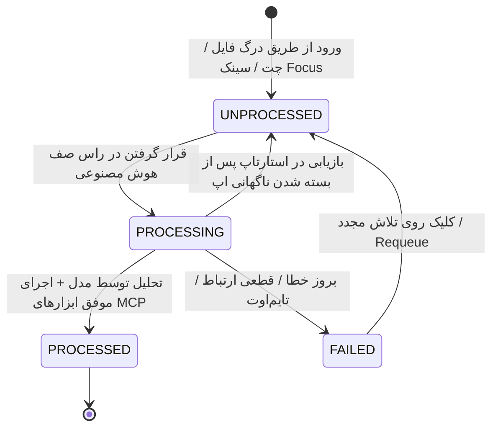

# سند جامع معماری فنی اپلیکیشن Mab-Compass (نسخه ۴.۰)
> **وضعیت سند:** معتبر برای نسخه ۴.۰ | **مخزن:** `mabacount/mab-compass` | **هدف:** مبنای مهندسی برای آپدیت سنگین بعدی

---

## ۱. چشم‌انداز و توپولوژی کلی سیستم (System Topology)

اپلیکیشن **Mab-Compass** یک سیستم‌عامل شخصی محلی و آفلاین‌محور (Local-First / Offline-First Desktop OS) برای پیوند دادن سه مفهوم حیاتی است:
1. **برنامه‌ریزی استراتژیک و خرد کردن کارها (5-Layer Domain Ontology)**
2. **استخراج خودکار دانش، متدها و ورک‌فلوهای BPMN 2.0 از گزارش‌های پراکنده**
3. **موتور اجرای متمرکز، مدیریت صف هوش مصنوعی و همگام‌سازی دوطرفه با Mab-Focus**

---

## ۲. آنتولوژی هسته ۵ لایه (The 5-Layer Ecosystem Model)

داده‌های کاربری در Mab-Compass به صورت سلسله‌مراتبی و علت‌ومعلولی از بالا به پایین تعریف می‌شوند:

### مشخصات لایه‌ها:
- **دومینو اجرایی (Top-3 Domino):** در هر لحظه، تنها ۳ تسک برتر از ۳ لاین کاری مجزا که پیش‌نیازهایشان حل شده و در وضعیت `READY` هستند انتخاب می‌شوند. هر تسک دارای فیلد `first_physical_action` (اقدام ۲ دقیقه‌ای جهت شکستن مقاومت شروع کار) است.
- **روش‌های انجام کار (Method Playbooks):** هر رویه و روال کاری تکرارپذیر به صورت خودکار به فرمت استاندارد BPMN 2.0 XML تبدیل شده و در پوشه `04_methods_playbooks/` پروژه در والت ذخیره می‌شود.

---

## ۳. کالبدشکافی معماری بک‌اند (Rust Backend Subsystems)

بک‌اند پروژه در پوشه `src-tauri/` قرار دارد و با زبان **Rust** پیاده‌سازی شده است:

### ۳.۱ لایه داده و پایگاه داده محلی SQLite
- **فایل اسکیما:** `src-tauri/src/db/schema.rs`
- **فایل کوئری‌ها:** `src-tauri/src/db/queries.rs`
- **ویژگی‌های کلیدی:**
  - فعال بودن `PRAGMA journal_mode = WAL` برای خواندن همزمان بدون بلاک شدن توسط نوشتن.
  - فعال بودن `PRAGMA busy_timeout = 5000` برای جلوگیری از خطای قفل دیتابیس در تراکنش‌ها.
  - جدول‌های اصلی: `projects`, `life_domains`, `outcomes`, `work_lines`, `work_entities`, `knowledge_documents`, `raw_events`, `pending_ai_queue`, `chat_messages`, `method_playbooks`.
  - پشتیبانی کامل از جستجوی متنی پرسرعت با ماژول **FTS5** در `raw_events_fts` و `knowledge_docs_fts`.

### ۳.۲ روتر هوش مصنوعی و لایه همزمانی (AI Routing & Concurrency)
- **فایل اصلی:** `src-tauri/src/llm/router.rs`
- **ابزارهای بومی MCP:** `src-tauri/src/mcp_tools.rs`
- **مکانیزم‌های محافظتی:**
  - **گیت انحصاری مدل لوکال (`LOCAL_OPENAI_GATE`):** یک `tokio::sync::Mutex` ایزوله که تضمین می‌کند در هر لحظه تنها یک درخواست به سرور LM Studio ارسال شود تا ترافیک موازی منابع کارت گرافیک و پردازنده را تقسیم نکند.
  - **بای‌پس پروکسی (`.no_proxy()`):** جلوگیری از هدایت ناخواسته ترافیک محلی `127.0.0.1:1234` به پروکسی‌های سیستمی ویندوز (مانند پورت ۱۰۸۰۸).
  - **مهلت زمانی ۳۶۰ ثانیه‌ای:** افزایش سقف مهلت پاسخگویی به ۶ دقیقه برای مدل‌های محلی فکری (Reasoning Models مانند `qwen3.5-4b`).
  - **سقف توکن آزاد (`max_tokens: 4096`):** اختصاص فضای کافی به توکن‌های استدلال درونی (`reasoning_content`) تا خروجی نهایی دچار انقطاع نشود.

### ۳.۳ موتور متدها و تولید BPMN 2.0
- **فایل اصلی:** `src-tauri/src/method_engine.rs`
- **وظایف:**
  - استخراج پلی‌بوک‌ها شامل عنوان، هدف، نقش‌ها، چک‌لیست‌ها و مراحل گام‌به‌گام.
  - تولید استاندارد XML سازگار با مشخصات BPMN 2.0 (شامل `startEvent`, `userTask`, `serviceTask`, `exclusiveGateway`, `subProcess`, `endEvent`).
  - موتور پشتیبان‌گیری اتمیک از دیتابیس SQLite با دستور `VACUUM INTO 'backup_path.db'` پیش از عملیات‌های سنگین بازپردازش.
  - اسکنر بازپردازش اسناد تاریخی با تزریق تگ‌های منشأ `LEGACY_REPROCESS` جهت جلوگیری از ایجاد تسک‌های تکراری.

---

## ۴. کالبدشکافی معماری فرانت‌اند (React 18 + TypeScript)

فرانت‌اند اپلیکیشن با طراحی مدرن **Dark Obsidian (الهام‌گرفته از Antigravity IDE)** در ساختاری ۳ ستونه پیاده‌سازی شده است:

```mermaid
graph LR
    subgraph Col1 ["ستون ۱: سایدبار ناوبری چپ (Sidebar)"]
        Tree["درخت پروژه‌ها + زمان‌های نسبی"]
        Shortcuts["میانبرهای سریع (مسیر پیش‌رو، متدها، اسناد و...)"]
        SettingsBtn["تنظیمات برنامه"]
    end

    subgraph Col2 ["ستون ۲: پنل چت و صف پردازش (Center Pane)"]
        QueueBanner["بنر صف در انتظار (Pending Queue Banner)"]
        ChatStream["فید پیام‌های چت (کارت‌های دارک راند)"]
        ArtifactCards["کارت‌های کلیک‌پذیر اسناد زیر پیام اسیستنت"]
        Composer["کامپوزر پیام + دکمه‌های ضمیمه فایل و توسعه"]
    end

    subgraph Col3 ["ستون ۳: بوم چندتبی راست (Right Canvas)"]
        TabStrip["نوار تب‌های باز شونده با منوی +"]
        PathView["تب ۱: مسیر پیش‌رو (Path Ahead)"]
        BpmnStudio["تب ۲: استودیوی متدها و BPMN 2.0"]
        WbsView["تب ۳: ساختار WBS و لاین‌های کاری"]
        ArchiveView["تب ۴: اسناد و بازپردازش حافظه"]
        DocViewer["تب ۵: نمایشگر Markdown / BPMN"]
    end

    Col1 ---|اسپلیتر ۱| Col2
    Col2 ---|اسپلیتر ۲| Col3
```

### ۴.۱ کامپوننت‌های کلیدی فرانت‌اند
| کامپوننت | فایل منبع | وظیفه اصلی |
| :--- | :--- | :--- |
| **هسته چیدمان** | `src/App.tsx` | مدیریت State کلان، درایور صف پس‌زمینه، هندلرهای مودال و هماهنگی ۳ ستون |
| **تایتل‌بار** | `src/components/AntigravityTitlebar.tsx` | نوار تیره frameless، وضعیت اتصال مدل، دکمه همگام‌سازی Focus و اکسپورت اکسل |
| **سایدبار چپ** | `src/components/AntigravitySidebar.tsx` | سوئیچ سریع بین پروژه‌ها، ایجاد مکالمه جدید و دسترسی به ویوهای تخصصی |
| **پنل چت** | `src/components/AntigravityChatPane.tsx` | رندر پیام‌های کاربر/مدل، نمایش کارت‌های سند تولیدشده در زیر پیام و دراور بررسی |
| **بوم تب‌های راست** | `src/components/AntigravityRightCanvas.tsx` | مدیریت تب‌های فعال و تاریخچه ناوبری بدون بارگذاری همزمان تب‌های مخفی |
| **ویوور BPMN 2.0** | `src/components/bpmn/BpmnViewer.tsx` | رندر گراف وکتور اینتراکتیو با زوم، پن و قابلیت دریل‌داون چندسطحی ساب‌پراسس‌ها |
| **موتور لی‌اوت گراف** | `src/lib/bpmnEngine.ts` | الگوریتم چیدمان توپولوژیک بر پایه DFS سه‌رنگ برای هدایت یال‌های برگشتی و چرخه |
| **اسپلیتر کشویی** | `src/components/ui/ResizableSplitPane.tsx` | تقسیم‌کننده‌های ریسپانسیو با ذخیره‌سازی ابعاد در LocalStorage (مشابه VS Code) |

---

## ۵. ماشین‌های حالت و چرخه داده‌ها (State Machines & Lifecycles)

### ۵.۱ چرخه حیات اسناد و پردازش داده‌ها

### ۵.۲ فرآیند درایور صف هوش مصنوعی (Queue Drainage Engine)
1. **بررسی اتصال:** مدل فعال بررسی می‌شود (`check_llm_connectivity`).
2. **بررسی قفل کاربر:** اگر کاربر در حال تایپ یا مکالمه فعال باشد، صف متوقف می‌ماند تا مزاحمتی ایجاد نشود.
3. **ارسال ترتیبی:** قدیمی‌ترین سند با `priority_order = 0` و وضعیت `PENDING` برداشته می‌شود.
4. **اجرای تراکنش هوش مصنوعی:**
   - ساخت پرامپت تلفیقی با تاریخچه، تسک‌های باز و استانداردهای ضدتکرار.
   - فراخوانی ابزارهای بومی MCP و ثبت متدها، تسک‌ها یا کارت‌های حافظه.
   - تبدیل وضعیت سند به `PROCESSED` و بروزرسانی آمار اقلام استخراج‌شده.
5. **کنترل خطا:** در صورت بروز خطا، یک زمان استراحت (Cooldown) موقت فعال شده و جزئیات خطا نمایش داده می‌شود.

---

## ۶. تحلیل بدهی‌های فنی و نقاط تمرکز برای «آپدیت سنگین» (Refactoring Hotspots)

برای آپدیت سنگین پیش‌رو، ساختار فعلی دارای چند ابرفایل (God Object) و گلوگاه مشخص است که بازطراحی آن‌ها سرعت و پایداری سیستم را به شدت ارتقا می‌دهد:

### ۱. شکستن ابرفایل‌های بک‌اند به ماژول‌های دامنه-محور
- `src-tauri/src/db/queries.rs` (بیش از ۵,۳۰۰ خط کد / ۲۰۸ کیلوبایت): باید به مخازن تخصصی شکسته شود:
  - `src-tauri/src/db/repos/project_repo.rs`
  - `src-tauri/src/db/repos/task_wbs_repo.rs`
  - `src-tauri/src/db/repos/knowledge_repo.rs`
  - `src-tauri/src/db/repos/method_repo.rs`
  - `src-tauri/src/db/repos/queue_repo.rs`
- `src-tauri/src/lib.rs` (بیش از ۲,۶۰۰ خط کد / ۹۲ کیلوبایت): دستورات `#[tauri::command]` باید به دایرکتوری `src-tauri/src/commands/` منتقل شوند.

### ۲. مهاجرت مدیریت State فرانت‌اند به Zustand
- در حال حاضر `src/App.tsx` با حجم ۵۱ کیلوبایت حامل ده‌ها State تودرتو است. استخراج این Stateها به استورهای مجزای Zustand (`useProjectStore`, `useChatStore`, `useCanvasStore`, `useQueueStore`) رندرهای اضافی کل صفحه ۳ ستونه را از بین می‌برد.

### ۳. نرمال‌سازی جدول ارتباط چت و آرتیفکت‌ها
- ستون متنی `written_artifacts_json` در `chat_messages` بهتر است به یک جدول رابط مستقل با کلید خارجی `FOREIGN KEY ... ON DELETE CASCADE` تبدیل شود تا ردیابی دوطرفه پیام‌ها و متدها سریع‌تر و بدون باگ لینک مرده انجام گیرد.

### ۴. تفکیک دقیق حالت «تمرکز/اجرا» از «معماری/برنامه‌ریزی» (Zen Focus Mode)
- اضافه کردن کلید میانبر (مانند `Ctrl+\`) برای مخفی کردن ستون چپ و بوم راست جهت تمرکز صددرصدی روی پیشبرد تسک فعال یا کار با چت.
